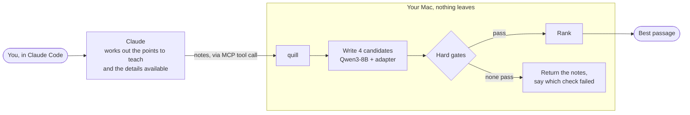
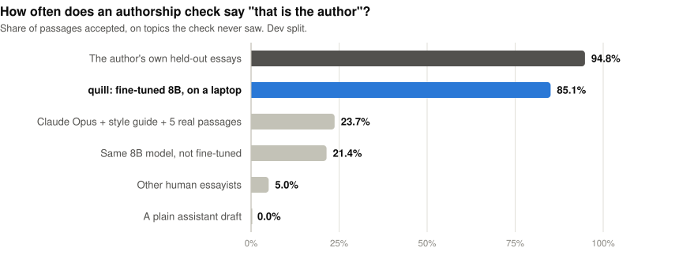
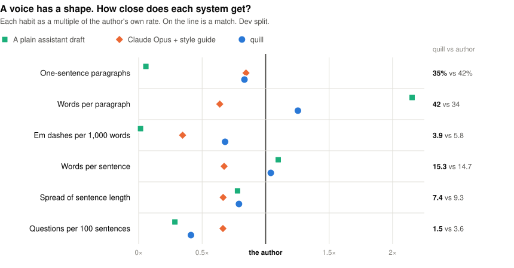

<h1 align="center">quill</h1>

<p align="center">
  A small model that runs on a Mac and writes exposition the way a good textbook does.<br>
  Claude works out the content. Quill writes the passage.
</p>

<p align="center">
  
  
  
  
  
</p>

---

## The target

This is the register quill is being trained to write. It is from *Computer Networks: A Systems Approach* by Larry Peterson and Bruce Davie.

> Network performance is measured in two fundamental ways: *bandwidth* (also called *throughput*) and *latency* (also called *delay*). The bandwidth of a network is given by the number of bits that can be transmitted over the network in a certain period of time. For example, a network might have a bandwidth of 10 million bits/second (Mbps), meaning that it is able to deliver 10 million bits every second. It is sometimes useful to think of bandwidth in terms of how long it takes to transmit each bit of data. On a 10-Mbps network, for example, it takes 0.1 microsecond (μs) to transmit each bit.
>
> Bandwidth and throughput are subtly different terms. First of all, bandwidth is literally a measure of the width of a frequency band. For example, legacy voice-grade telephone lines supported a frequency band ranging from 300 to 3300 Hz; it was said to have a bandwidth of 3300 Hz - 300 Hz = 3000 Hz. If you see the word *bandwidth* used in a situation in which it is being measured in hertz, then it probably refers to the range of signals that can be accommodated.

<sub>Section 1.5.1. Copyright Elsevier, 2012. Source: <a href="https://github.com/SystemsApproach/book">github.com/SystemsApproach/book</a>, CC BY 4.0.</sub>

And this is Claude Opus, asked to explain binary search "in the manner of a high-quality textbook":

> Binary search is a method for finding a target value in a list. A target is the item being sought. Binary search requires that the list be sorted, meaning its items are arranged in order from smallest to largest. Without this ordering, the method cannot work.
>
> The search proceeds in steps. At each step, the method examines the middle item of the portion of the list that remains under consideration. It compares the target with this middle item. If the two are equal, the search ends. If the target is smaller, every item after the middle can be discarded.

The second is correct and orderly. It also reads like a checklist being obeyed. The differences are specific:

| | Prompted Claude | The textbook |
|---|---|---|
| Definitions | States each one and moves on | Gives it, then gives it again another way ("how long it takes to transmit each bit") |
| Examples | Generic, one per point | Numeric and worked through (3300 Hz − 300 Hz = 3000 Hz) |
| Near-synonyms | Left alone | Separated, with a rule for telling them apart |
| Flow | Each sentence stands alone | Each sentence leans on the one before |
| Sentence length | 12 words on average, little variation | 23 words on average, wide variation |
| Stance | Instructions being followed | An author deciding what the reader needs next |

The goal is to close that gap: exposition that an expert reader prefers to what Claude writes when told to write like a textbook. The judge is the person using the tool. General-audience appeal is not a goal.

> **Where it stands.** The pipeline, the evaluation harness and two corpora are built. A first experiment (imitating an essayist's voice) worked and showed what fine-tuning can and cannot move. The experiment aimed at the target above has now run, and its first result is negative: the adapter learned the book's voice and wrote less coherent exposition than Claude given the same notes and three real passages. Nothing is served as a tool. Numbers come from [eval_reports/](eval_reports/); the day-by-day record is the [logbook](knowledge_base/logbook.md).

## What quill does



The input is notes in two parts. **CORE** holds the few points the passage should teach. **MATERIAL** holds the details it may draw on, as bare data in no particular order.

```
CORE:
- Web caching can be done at several locations: the user's browser, a site-wide
  shared cache, or inside an ISP.
- A site-wide cache is known to its users, who configure browsers to connect to
  it directly; this node is called a proxy.
- An ISP cache is transparent: sites don't know of it, and a router on the path
  caches pages by inspecting requests.
MATERIAL:
- Router reads the URL in the request message.
- Browser cache: recently accessed pages, shown again on revisit.
- ISP = Internet Service Provider; sits nearer the middle of the Internet.
- Router watches for the server's response passing in the opposite direction.
```

Quill decides the order, which point to restate, where a detail becomes an example, and how one sentence leads to the next. It may not add a name, number, date or link that the notes lack. Four candidates are written, and a candidate is dropped if it:

- adds or loses a name, number, date or link
- runs 30% over or under the requested length
- copies eight or more words in a row from the training corpus
- contains chatbot residue ("Certainly! Here's...")

If no candidate survives, quill returns the notes and names the check that failed.

## Training

Each training example pairs a real textbook passage with notes cut down from it.


- Claude reads the passage and writes the notes: three to six core points with no examples or restatements, and the specific details as data.
- The details are shuffled, so the passage's order is not handed to the model.
- A name or number the notes missed is added back, so everything factual in the target is in the input. The model learns to explain and arrange. It does not learn to supply facts.
- First build: 428 training pairs from 475 passages ([report](eval_reports/tb/explain-v1.md)).

The corpus is one book so far: 61 sections, 213,738 words, taken from the book's source repository under CC BY 4.0. [knowledge_base/corpus_research.md](knowledge_base/corpus_research.md) lists which other open textbooks can be added and which cannot (OpenStax, for one, now forbids use in LLM training).

## How it got here

### Experiment 1: an essayist's voice

The project began as style imitation: make a draft sound like one writer, Morgan Housel, using his essays for Collaborative Fund (with Collaborative Fund's consent). The method was *style inversion*. Each passage is flattened into a plain paraphrase and a generic draft, and the model learns the trip back. Every fact in a target is already in its input.

It worked. The chart shows how often an authorship check, trained to tell this author from other essayists and from AI drafts of his own material, accepts a passage as his.

<picture>
  <source media="(prefers-color-scheme: dark)" srcset="assets/ladder-dark.svg">
  
</picture>

Countable habits moved too. Each system's rate is shown as a multiple of the author's own.

<picture>
  <source media="(prefers-color-scheme: dark)" srcset="assets/fingerprint-dark.svg">
  
</picture>

| System, dev split, 4 candidates | Accepted as the author | Read as an LLM | Meaning kept | Falls back to the input |
|---|---|---|---|---|
| The author's own held-out essays | 94.8% | | | |
| Claude Opus + style guide + 5 passages | 23.7% | 72.4% | | 16.1% |
| Qwen3-8B, not fine-tuned | 21.4% | 77.3% | 0.87 | 14.5% |
| Quill, trained on paraphrases | 72.4% | 23.7% | 0.89 | 10.5% |
| **Quill, trained on paraphrases and drafts** | **85.1%** | **9.1%** | **0.90** | **12.9%** |

Findings from that work that still hold:

- **Training on drafts alone reaches the author's ceiling and breaks the facts.** That adapter was accepted 98% of the time, and four in ten of its candidates lost or added a name or number. Training on paraphrases and drafts together kept most of the style and held the facts.
- **Most dropped facts came from the drafter.** When the untuned model wrote a draft from notes, two thirds of its drafts already lost or added an item. Redrafting with the missing items named cut the fallback rate from 30% to 10%.
- **Merging the adapter into 4-bit weights erases it.** The merged model scored like the untuned one. Merging at full precision and re-quantizing to 6 bits keeps the voice and runs at 32 tokens a second.
- **A zero-shot AI detector could not tell Opus's imitation from the author** (AUC 0.50). It was dropped.

### Why that was not enough

Tried on ordinary informational writing, the essayist's voice came out as short stories and proverbs. An essayist's moves, an anecdote and then a moral, have nowhere to go in a walkthrough. So the corpus changed to a textbook, and the same method was run again.

It did not beat prompted Claude. The reason is in how the method works:

- **Style inversion holds content fixed.** Every example and every ordering decision in a target is already in its input. The model learns the surface: rhythm, paragraphing, word choice.
- **An essayist's voice is on the surface.** That is why experiment 1 worked.
- **A textbook's surface is plain.** A neutral paraphrase of textbook prose is nearly a copy of it (81% word overlap, against 72% for the essayist). Given Claude's own textbook-style prose, the restyling adapter returned it almost unchanged.
- **A textbook's quality is in content decisions:** which example to work, which confusion to head off, what to say next. A restyler is forbidden from making those and never sees one made.

Hence the notes-to-passage task above. The model is given less and has to decide more.

### First result on the new task

One adapter, one book, 428 pairs, one pass. Three systems wrote from the same 34 held-out notes ([reports](eval_reports/tb/)).

| | Quill | Claude, textbook instruction | Claude + 3 real passages |
|---|---|---|---|
| Voice check accepts as the book | 97.5% | 4.3% | 37.8% |
| Sentence length, mean and spread (book: 22.6, 11.6) | 19.4, 10.0 | 17.8, 7.7 | 19.4, 8.6 |

- **The adapter has the voice.** By every style measure it sounds like the book, far more than Claude does.
- **It loses on what matters here.** Read side by side, its passages lose the thread, repeat themselves and make errors. On topics outside the book they came out short and thin.
- **Claude with exemplars reaches the register.** Shown three real passages, Claude motivates before defining, restates, says why a detail matters, and stays correct. The stiffness of the instruction-only version goes away.
- **Claude also recites.** On the book's own held-out sections, its output with exemplars shares a median 24-word span with text it was never shown, and once 262 words. Comparisons on the book's own material favour it unfairly; new topics are the fair test.
- **The entity gate does not work on notes input.** Half of Claude's own outputs fail it. It needs the form-tolerant check for this task.

The plain reading: an 8B model can copy a voice; it does not match a frontier model's judgement about what to explain, and that judgement is what textbook quality is made of.

### What is not established

- **Whether fine-tuning can help at all here.** This was a small test. More pairs of the same kind would mostly add voice.
- **A human pick.** The comparison above is the builder's reading plus style statistics. Blind pairs judged by the user are the real test; about 85 picks detect a 65% preference.
- **Whether one networking book teaches exposition or networking.** More books from other subjects are needed before saying anything about transfer.
- **Dev sets are small and reused.** The test splits are untouched.

## Roadmap

| | Step | State |
|---|---|---|
| ✓ | Sources, consent and licence records | Done for both corpora; stored consent copies pending |
| ✓ | Extraction and cleaning | Done. Essays: 330 posts, 318,971 words. Textbook: 61 sections, 213,738 words |
| ✓ | Splits, eval harness, baselines | Done for the essays; textbook baselines running |
| ✓ | Base model | Qwen3-8B. Qwen3.5-9B could not be trained on this Mac with mlx-lm ([logbook](knowledge_base/logbook.md)) |
| ✓ | Restyling adapters | Essays: works (0.76 dev composite against 0.26 untuned). Textbook: no gain over prompted Claude |
| ● | Notes-to-passage adapter | First run done: has the book's voice, loses to Claude with exemplars on coherence. Direction under review |
| | Inference pipeline | Gates, rerank and the drafter retry exist as eval code |
| | Ship gate | Blind picks against Claude with exemplars; then one run on the test split |
| | MCP serving in Claude Code | |

The full plan is [knowledge_base/plan.md](knowledge_base/plan.md). The plan for the essayist experiment, with every threshold and its source, is [archived](knowledge_base/archive/plan-v2-essayist.md).

## Run it

Needs [uv](https://docs.astral.sh/uv/), Python 3.12 and an Apple Silicon Mac.

```
uv sync
uv run pytest
```

The repo holds code and aggregate numbers only. Bring your own corpus, one you have the right to use. Data lives in `~/.quill/`, outside the repo; raw pages go in `~/.quill/raw/collabfund/pages/`. Paths and thresholds are in [configs/quill.yaml](configs/quill.yaml).

```
uv run quill ingest                  # pages -> clean, deduped chunks
uv run quill split                   # freeze topic-disjoint train/dev/test
uv run quill eval --sanity           # prove each metric works before trusting it
uv run quill baseline b0             # the bar: Claude + style guide + exemplars
uv run quill pairs                   # build and curate the restyle pairs
uv run quill train NAME --stage s1p  # fine-tune an adapter with mlx-lm
uv run quill run NAME --adapter NAME --tag paraphrase --n 4   # generate on dev and score
```

A second corpus gets its own config, data folder and reports folder. The textbook voice:

```
C="--config configs/textbook.yaml"
uv run quill $C ingest               # Sphinx source -> chunks, under ~/.quill/tb/
uv run quill $C split
uv run quill $C pairs --explain      # notes (CORE + MATERIAL) -> passage pairs
uv run quill $C train tb-x1 --stage x1
uv run quill $C explain tb-x1 --adapter tb-x1 --n 4      # write from held-out notes, score
uv run quill $C explain bt-ex --claude exemplars         # the baseline to beat
uv run quill $C explain --kit tb-x1 bt-ex                # blind reading kit
```

<details>
<summary><b>Every command</b></summary>

| Command | What it does |
|---|---|
| `uv run quill audit` | Inventories the raw pages and checks them against the Phase 0 figures |
| `uv run quill ingest` | Extracts, cleans, dedupes and chunks the pages into `~/.quill/corpus/corpus.sqlite`; writes `cleaning_report.md` |
| `uv run quill aicheck` | Builds lexicon v0 and flags posts dated after 2022-12-01 for review; writes `ai_flags.md` |
| `uv run quill flags [slug keep\|drop]` | Lists the flags, or records a decision on one |
| `uv run quill spotcheck [--seed S] [--record N --note TEXT]` | Writes 100 random chunks for a read; records the count of bad ones |
| `uv run quill gate` | Shows the Phase 1 exit gate |
| `uv run quill split` | Freezes topic-disjoint train/dev/test splits, or shows the frozen ones |
| `uv run quill eval --sanity` | Checks each style metric on dev and recomputes the within-author ceiling |
| `uv run quill eval --system NAME --split dev` | Scores a system; reports go to `eval_reports/` |
| `uv run quill eval --verifiers` | Compares the style scorers on author text against plain drafts of the same content |
| `uv run quill inputs` | Makes and freezes the eval inputs for dev and test: facts, a brief and a generic draft per chunk (Claude, through `claude -p`) |
| `uv run quill baseline b0\|b1\|b2 [--split dev] [--n 4]` | Runs and scores a baseline: Claude with a style guide and exemplars, the untuned local base, or the draft itself |
| `uv run quill recall [--split dev] [--adapter NAME]` | Probes the base, untuned or with an adapter loaded, for verbatim recall of the corpus |
| `uv run quill eval --compare A B` | Paired bootstrap of the decision composite, A minus B |
| `uv run quill eval --detector` | Sanity check of the machine-text detector (M10) |
| `uv run quill judge` | Validates the Claude pairwise judge (M11) and compares the scored systems |
| `uv run quill blind --test A\|R --system NAME` | Builds a blind reading kit, runs the read in the terminal, reports the binomial p |
| `uv run quill baseline b1 --split coverage` | Coverage probe on your own briefs in `~/.quill/eval/coverage/briefs.jsonl` |
| `uv run quill eval --report` | Writes the Phase 2 exit report |
| `uv run quill pairs` | Paraphrases each train and dev chunk, curates both pair forms, writes the MLX chat data and `eval_reports/pairs-v1.md` |
| `uv run quill pairs --local` | Adds the local half of the draft pairs: the untuned base drafts from each fact list. No Claude calls |
| `uv run quill train NAME [--stage s1\|s1p\|s2\|s2m] [--resume ADAPTER] [--lr LR] [--passes N]` | Trains an adapter with mlx-lm on one pair set; logs loss, speed and peak memory |
| `uv run quill run NAME --adapter ADAPTER [--tag paraphrase\|draft] [--n 4] [--fused PATH]` | Generates with an adapter (or a merged copy) on the eval inputs and scores it |
| `uv run quill pairs --explain` | Builds the notes-to-passage pairs: Claude reduces each chunk to CORE points and MATERIAL details; curates; writes the MLX data and a report |
| `uv run quill explain NAME --adapter A \| --claude plain\|exemplars [--n 4]` | Writes passages from held-out notes with an adapter or with Claude, and scores them |
| `uv run quill explain --kit A B` | Writes a blind reading kit pairing two systems' passages on the same notes; the key goes in a separate file |
| `uv run python scripts/compare_examples.py` | Claude writes a brief; quill restyles it. Pairs stay under `~/.quill/` |
| `uv run python scripts/readme_charts.py` | Redraws the README charts from the reports in `eval_reports/` |

Run them in that order. `inputs`, `baseline b0`, `judge` and `pairs` send corpus text to Claude; they stop unless `scope.yaml` says `claude_api: yes`. `baseline b1` and `recall` need the base model at the `gen.base_model` path. The meaning, LUAR and detector scorers need local model copies under `~/.quill/models/` (`mis`, `luar-mud`, `gpt-neo-2.7b`). A rebuild with `ingest` keeps flag decisions and clears the spot-check result.

</details>

<details>
<summary><b>What the cleaning pipeline does</b></summary>

1. **Extract.** A parser for the Collab Fund page layout keeps body paragraphs, list items and headings. It drops navigation, share bars, newsletter boxes and captions.
2. **Clean.** Block quotes, embedded tweets, epigraphs, whole-paragraph quotations, related-post lists, promo lines and separators go. Every dropped block is stored with a reason.
3. **Drop posts.** Posts by other authors, posts under 120 words, and posts named in `corpus.drop_posts` (book announcements, interviews, a transcript).
4. **Twins.** Posts that share more than 30% of their 10-grams get a `twin_group`, so they stay on one side of every split.
5. **Dedupe.** MinHash over paragraphs keeps the earliest copy of each repeated paragraph.
6. **Chunk.** 150-800 words on paragraph boundaries, in three length buckets. Chunks carry flags such as `list`, `quote_gap` and `dangling_leadin`. `text` holds the author's words only; `text_marked` adds a `<QUOTE>` or `<IMAGE>` line where one was removed.
7. **AI-text check.** Three review signals on later posts: lexicon rates above the author's own pre-cutoff 95th percentile, a sustained style shift (PELT), and LLM mentions or chatbot referrer links. Nothing is dropped without a decision.
8. **PII.** A regex pass for email addresses and phone numbers.

</details>

<details>
<summary><b>Repo layout</b></summary>

```
configs/
  quill.yaml            paths, thresholds, dropped posts, decisions
  textbook.yaml         the same for the textbook voice (own data and reports folders)
  lexicon/              seed lexicon v0 and the Kobak excess-word list
  prompts/              prompts for eval inputs, pairs, B0/B1, the judge and the recall probe
  train/                mlx-lm training configs
src/quill/
  cli.py                the commands above
  template.py           the one prompt template, shared by training and serving
  audit.py              Phase 0 inventory
  ingest/               collabfund (HTML page parser), rst (Sphinx textbook source), textlib (the Phase 0 reader and stylometrics)
  clean/                boilerplate, twins, dedupe, chunk, pii_regex, ai_check
  corpus/               build (the pipeline), store (SQLite), gate, split
  scorers/              lexicon, contrast, av (verifier, attribution), stylometry, memo, entities, embed, meaning (MIS, fact entailment), detect
  gen/                  claude_cli (`claude -p` with a cache), local (mlx-lm with a cache)
  eval/                 pool, harness (metrics, composite), inputs, baselines (B0-B2, recall probe), vcheck, judge, blind, coverage
  train.py              one mlx-lm training stage: config, schedule, log parsing
  pairs/                generate (paraphrases, marker placement), curate, local (base-model drafts), explain (notes -> passage), to_mlx, build
eval_reports/           aggregate metrics only; tb/ holds the textbook voice's reports
assets/                 README charts (SVG), drawn by scripts/readme_charts.py
scripts/                readme_charts.py, compare_examples.py
tests/                  synthetic text only; no corpus text
knowledge_base/         plan, experiment logbook, follow-up queue, corpus research, literature review, archive of earlier plans
```

</details>

## Ground rules

The model imitates a living writer. These rules apply, and the ones that can be enforced in code are.

- **Consent and licence first.** Each corpus has a record under `~/.quill/legal/`: the rights holder's consent for the essays, the CC BY 4.0 licence and consent for the textbook. A use marked unknown there is blocked. Publishing model outputs is marked unknown for both, which is why this README shows none.
- **Honour opt-outs.** A source whose robots.txt, terms or author says no to AI use is not used without the rights holder's agreement. Several strong candidates were excluded on that ground ([corpus_research.md](knowledge_base/corpus_research.md)).
- **Local only.** The corpus, adapters and weights never leave the machine and are not in this repo. `.gitignore` blocks weights, databases, JSONL and HTML.
- **No passing off.** Outputs are never presented as an author's own writing. Tool, file and adapter names never carry an author's name.
- **No copying.** A hard gate rejects any output that shares a long verbatim span with the corpus. One known limit: given a close paraphrase of one of the author's own passages, a restyling adapter rebuilds some of the original wording. That is measured and reported, not gated.
- **Polite crawling.** Raw pages are cached once and never re-fetched. Crawls honour robots.txt, AI opt-outs and crawl delays.

Details are in [knowledge_base/plan.md](knowledge_base/plan.md), section 2.4. Nothing here is legal advice.

## Credits

- Textbook corpus and the passage quoted above: *Computer Networks: A Systems Approach*, Larry Peterson and Bruce Davie. Copyright Elsevier, 2012. Source: [github.com/SystemsApproach/book](https://github.com/SystemsApproach/book). Licence: [CC BY 4.0](https://creativecommons.org/licenses/by/4.0). The text is not redistributed in this repository.
- `configs/lexicon/kobak_excess_words.csv`: Kobak et al., [llm-excess-vocab](https://github.com/berenslab/llm-excess-vocab), MIT. Licence in `configs/lexicon/kobak_LICENSE`.
- `src/quill/scorers/contrast.py`: a port of the stage-1 regexes from [slop-score](https://github.com/sam-paech/slop-score), Copyright (c) 2025 Sam Paech, MIT.
- Models used locally, not redistributed: [Mutual Implication Score](https://huggingface.co/s-nlp/Mutual_Implication_Score) (CC BY-NC-SA 4.0), [LUAR-MUD](https://huggingface.co/rrivera1849/LUAR-MUD), [StyleDistance](https://huggingface.co/StyleDistance/styledistance), [gpt-neo-2.7B](https://huggingface.co/EleutherAI/gpt-neo-2.7B), [DeBERTa-v3 MNLI](https://huggingface.co/MoritzLaurer/DeBERTa-v3-base-mnli-fever-anli), spaCy `en_core_web_sm`.
- `configs/lexicon/seed_v0.yaml`: vocabulary and patterns drawn from Wikipedia's [Signs of AI writing](https://en.wikipedia.org/wiki/Wikipedia:Signs_of_AI_writing), CC BY-SA 4.0.
