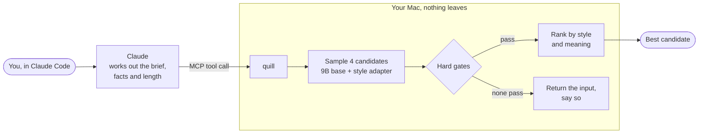
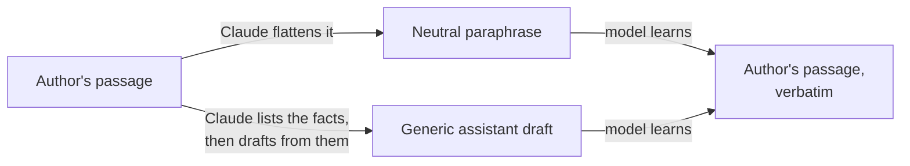

<h1 align="center">quill</h1>

<p align="center">
  <b>Claude decides what to say. Quill decides how it sounds.</b><br>
  A style model that runs on your Mac and rewrites drafts in one author's voice.
</p>

<p align="center">
  
  
  
  
  
</p>

---

Ask a frontier model to "write like" a specific author and you get a costume: the right topics, the wrong sentences. We measured it. Claude, given a style guide and five real passages, passes an authorship check **24%** of the time. The author's own held-out writing passes **95%** of the time.

Quill is the attempt to close that gap with weights, not prompts. It is a QLoRA adapter on a 9B open-weight model, trained and served on an Apple Silicon Mac with MLX, and exposed to Claude Code as an MCP tool. Prompt-only imitation is out of scope.

The first voice: Morgan Housel's essays on the Collaborative Fund blog, used with Collaborative Fund's consent.

> **Where it stands.** The corpus, the evaluation harness, the baselines and the training pairs are done. The model bake-off is next. No adapter has been trained yet, so nothing below is a demo of one. The numbers are the bar it has to clear.

## The gap

Share of passages a verifier accepts as the author's (dev split, topics the verifier never saw):

```
The author, held out   ███████████████████████████████████████  94.8%
Claude + style guide   ██████████                               23.7%   <- the bar to beat
Untuned local 9B       █                                         1.6%
Plain draft                                                      0.0%
Other human essayists  ██                                        5.0%
```

A Claude judge, shown the real passage beside Claude's best imitation of the same content, picked the real one 32 times and the imitation once.

Full report: [eval_reports/baseline-v2.md](eval_reports/baseline-v2.md).

## How it works



Four candidates go in. A candidate is thrown out if it:

- drops or adds a name, number, date or link
- drifts from the input's meaning
- copies eight or more words in a row from the corpus
- contains chatbot artifacts ("Certainly! Here's...")

The survivors are ranked on style and meaning. If nothing survives, Quill returns your input untouched and tells you why. It never bluffs.

### The tool, as Claude will call it

```jsonc
// restyle: you have a draft
{ "tool": "restyle",
  "draft": "Compounding works slowly at first and then quickly. Most of the gains arrive late, which is why patience matters more than skill.",
  "length_words": 300 }

// write: you have a brief and facts
{ "tool": "write",
  "brief": "A short essay on why most investing gains come late.",
  "facts": ["$81.5B of Buffett's $84.5B net worth came after his 65th birthday"] }
```

```jsonc
// both return
{ "text": "...",
  "status": "ok",              // or "fallback", with reasons
  "checks": { "entities": "kept", "meaning": 0.91, "longest_copied_span": 3 },
  "output_id": "..." }
```

This is the contract, not captured output. The serving layer is Phase 9.

## The trick: style inversion

You cannot train "write like this author" directly without teaching the model to make things up. So the training data runs backwards.



Every passage is turned into two plain versions of itself. The model learns the trip back. Each fact in a target already sits in its input, so the model learns to restyle and never to invent.

One training example (synthetic text; the real corpus is not in this repo):

```json
{"messages": [
  {"role": "system",    "content": "quill v2\nop: restyle\ninput: draft\nlength: 150-300\nvoice: v0"},
  {"role": "user",      "content": "Warren Buffett purchased his first share in 1942, when he was 11. Most of his wealth arrived over the following 60 years."},
  {"role": "assistant", "content": "Warren Buffett bought his first stock in 1942. He was 11 years old. It took him 60 years to make most of his money."}
]}
```

Pairs are curated before training. A pair is dropped when the target holds a fact the input lacks, when meaning drifts, when the input is a near-copy, or when the example will not fit the context window.

## Measured before trained

The evaluation harness came first, on purpose. A model that grades its own homework always passes.

| Question | How it is answered |
|---|---|
| Does it sound like the author? | An authorship verifier (character n-grams) trained against other essayists *and* against Claude drafts of the author's own content, so it cannot win on topic |
| Whose voice is it closest to? | A four-way attributor: the author, a close neighbour, other humans, an LLM |
| Did the meaning survive? | Mutual Implication Score for rewrites; fact-by-fact entailment for new text |
| Did any fact change? | A hard gate on names, numbers, dates and links |
| Is it copying? | Longest verbatim span against the whole corpus, plus a recall probe on the base model |
| Does a person agree? | A blind reading kit: 40 pairs, pick the real one, binomial test |

Splits are topic-disjoint. The model is tested on subjects it never trained on, so a high score means voice, not memory.

Some results worth knowing:

- **Topic was not the leak, LLM-ness was.** The first verifier accepted about half of plain Claude drafts. Masking content words made it worse. Adding Claude drafts of the author's own content as negatives fixed it.
- **A zero-shot AI detector is useless here.** Fast-DetectGPT cannot tell Claude's imitation from the author (AUC 0.50). It was dropped.
- **The base model already knows some of the corpus.** The untuned 9B reproduced a 12-word span when asked. That is the ceiling the adapter must not raise.

## Roadmap

| | Phase | State |
|---|---|---|
| ✓ | 0 Source and consent audit | Done, except the stored consent copy |
| ✓ | 1 Extraction and cleaning | Done. 330 posts, 318,971 words, 835 chunks |
| ✓ | 2 Splits, eval harness, baselines | Done on dev. Exit gate passes |
| ✓ | 3 Training pairs | Done. 675 paraphrase pairs and 641 draft pairs survive curation; 92.6% of train chunks keep both ([report](eval_reports/pairs-v1.md)). A human read of 50 pairs is still open |
| ● | 4 Model bake-off | In progress. Base is Qwen3-8B ([why](knowledge_base/logbook.md)). The stage-1 adapter pipeline scores 0.68 on the dev composite against 0.26 for the untuned base and 0.25 for prompted Opus; fallback is 10.5% |
| | 5 Style fine-tune and ablations | |
| | 6 Inference pipeline | |
| | 8 Ship gate | Blind reads on the untouched test split |
| | 9 MCP serving in Claude Code | |

The ship gate is strict. The adapter ships only if a reader who knows the author cannot reliably pick the real passage (at most 25 of 40), and it beats Claude's imitation head to head (at least 26 of 40). The full plan, with every threshold and its source, is in [knowledge_base/plan.md](knowledge_base/plan.md).

## Run it

Needs [uv](https://docs.astral.sh/uv/), Python 3.12 and an Apple Silicon Mac.

```
uv sync
uv run pytest
```

The repo holds code and aggregate numbers only. Bring your own corpus, one you have the right to use. Data lives in `~/.quill/`, outside the repo; raw pages go in `~/.quill/raw/collabfund/pages/`. Paths and thresholds are in [configs/quill.yaml](configs/quill.yaml).

```
uv run quill ingest                  # pages -> clean, deduped chunks
uv run quill split                   # freeze topic-disjoint train/dev/test
uv run quill eval --sanity           # prove each metric works before trusting it
uv run quill baseline b0             # the bar: Claude + style guide + exemplars
uv run quill pairs                   # build and curate the training pairs
```

<details>
<summary><b>Every command</b></summary>

| Command | What it does |
|---|---|
| `uv run quill audit` | Inventories the raw pages and checks them against the Phase 0 figures |
| `uv run quill ingest` | Extracts, cleans, dedupes and chunks the pages into `~/.quill/corpus/corpus.sqlite`; writes `cleaning_report.md` |
| `uv run quill aicheck` | Builds lexicon v0 and flags posts dated after 2022-12-01 for review; writes `ai_flags.md` |
| `uv run quill flags [slug keep\|drop]` | Lists the flags, or records a decision on one |
| `uv run quill spotcheck [--seed S] [--record N --note TEXT]` | Writes 100 random chunks for a read; records the count of bad ones |
| `uv run quill gate` | Shows the Phase 1 exit gate |
| `uv run quill split` | Freezes topic-disjoint train/dev/test splits, or shows the frozen ones |
| `uv run quill eval --sanity` | Checks each style metric on dev and recomputes the within-author ceiling |
| `uv run quill eval --system NAME --split dev` | Scores a system; reports go to `eval_reports/` |
| `uv run quill eval --verifiers` | Compares the style scorers on author text against plain drafts of the same content |
| `uv run quill inputs` | Makes and freezes the eval inputs for dev and test: facts, a brief and a generic draft per chunk (Claude, through `claude -p`) |
| `uv run quill baseline b0\|b1\|b2 [--split dev] [--n 4]` | Runs and scores a baseline: Claude with a style guide and exemplars, the untuned local base, or the draft itself |
| `uv run quill recall [--split dev]` | Probes the untuned base for verbatim recall of the corpus |
| `uv run quill eval --compare A B` | Paired bootstrap of the decision composite, A minus B |
| `uv run quill eval --detector` | Sanity check of the machine-text detector (M10) |
| `uv run quill judge` | Validates the Claude pairwise judge (M11) and compares the scored systems |
| `uv run quill blind --test A\|R --system NAME` | Builds a blind reading kit, runs the read in the terminal, reports the binomial p |
| `uv run quill baseline b1 --split coverage` | Coverage probe on your own briefs in `~/.quill/eval/coverage/briefs.jsonl` |
| `uv run quill eval --report` | Writes the Phase 2 exit report |
| `uv run quill pairs` | Paraphrases each train and dev chunk, curates both pair forms, writes the MLX chat data and `eval_reports/pairs-v1.md` |

Run them in that order. `inputs`, `baseline b0`, `judge` and `pairs` send corpus text to Claude; they stop unless `scope.yaml` says `claude_api: yes`. `baseline b1` and `recall` need the base model at the `gen.base_model` path. The meaning, LUAR and detector scorers need local model copies under `~/.quill/models/` (`mis`, `luar-mud`, `gpt-neo-2.7b`). A rebuild with `ingest` keeps flag decisions and clears the spot-check result.

</details>

<details>
<summary><b>What the cleaning pipeline does</b></summary>

1. **Extract.** A parser for the Collab Fund page layout keeps body paragraphs, list items and headings. It drops navigation, share bars, newsletter boxes and captions.
2. **Clean.** Block quotes, embedded tweets, epigraphs, whole-paragraph quotations, related-post lists, promo lines and separators go. Every dropped block is stored with a reason.
3. **Drop posts.** Posts by other authors, posts under 120 words, and posts named in `corpus.drop_posts` (book announcements, interviews, a transcript).
4. **Twins.** Posts that share more than 30% of their 10-grams get a `twin_group`, so they stay on one side of every split.
5. **Dedupe.** MinHash over paragraphs keeps the earliest copy of each repeated paragraph.
6. **Chunk.** 150-800 words on paragraph boundaries, in three length buckets. Chunks carry flags such as `list`, `quote_gap` and `dangling_leadin`. `text` holds the author's words only; `text_marked` adds a `<QUOTE>` or `<IMAGE>` line where one was removed.
7. **AI-text check.** Three review signals on later posts: lexicon rates above the author's own pre-cutoff 95th percentile, a sustained style shift (PELT), and LLM mentions or chatbot referrer links. Nothing is dropped without a decision.
8. **PII.** A regex pass for email addresses and phone numbers.

</details>

<details>
<summary><b>Repo layout</b></summary>

```
configs/
  quill.yaml            paths, thresholds, dropped posts, decisions
  lexicon/              seed lexicon v0 and the Kobak excess-word list
  prompts/              prompts for eval inputs, pairs, B0/B1, the judge and the recall probe
  train/                mlx-lm training configs
src/quill/
  cli.py                the commands above
  template.py           the one prompt template, shared by training and serving
  audit.py              Phase 0 inventory
  ingest/               page parser; textlib (the Phase 0 reader and stylometrics)
  clean/                boilerplate, twins, dedupe, chunk, pii_regex, ai_check
  corpus/               build (the pipeline), store (SQLite), gate, split
  scorers/              lexicon, contrast, av (verifier, attribution), stylometry, memo, entities, embed, meaning (MIS, fact entailment), detect
  gen/                  claude_cli (`claude -p` with a cache), local (mlx-lm with a cache)
  eval/                 pool, harness (metrics, composite), inputs, baselines (B0-B2, recall probe), vcheck, judge, blind, coverage
  pairs/                generate (paraphrases, marker placement), curate, to_mlx, build
eval_reports/           aggregate metrics only
tests/                  synthetic text only; no corpus text
knowledge_base/         plan, experiment logbook, literature review, research notes, decision docs
```

</details>

## Ground rules

Imitating a living writer is a thing to do carefully or not at all.

- **Consent first.** The corpus is used under the rights holder's consent, recorded in `~/.quill/legal/scope.yaml`. Any use marked unknown there is blocked in code.
- **Local only.** The corpus, adapters and weights never leave the machine and are not in this repo. `.gitignore` blocks weights, databases, JSONL and HTML.
- **No passing off.** Outputs are never presented as the author's own writing. Tool, file and adapter names never carry the author's name.
- **No copying.** A hard gate rejects any output that shares a long verbatim span with the corpus. One known limit: given a close paraphrase of one of the author's own passages, the adapter rebuilds some of the original wording. That is measured and reported, not gated; the tool is for restyling your own drafts.
- **Polite crawling.** Raw pages are cached once and never re-fetched. Crawls honour robots.txt, AI opt-outs and crawl delays.

Details are in [knowledge_base/plan.md](knowledge_base/plan.md), section 2.4. Nothing here is legal advice.

## Credits

- `configs/lexicon/kobak_excess_words.csv`: Kobak et al., [llm-excess-vocab](https://github.com/berenslab/llm-excess-vocab), MIT. Licence in `configs/lexicon/kobak_LICENSE`.
- `src/quill/scorers/contrast.py`: a port of the stage-1 regexes from [slop-score](https://github.com/sam-paech/slop-score), Copyright (c) 2025 Sam Paech, MIT.
- Models used locally, not redistributed: [Mutual Implication Score](https://huggingface.co/s-nlp/Mutual_Implication_Score) (CC BY-NC-SA 4.0), [LUAR-MUD](https://huggingface.co/rrivera1849/LUAR-MUD), [StyleDistance](https://huggingface.co/StyleDistance/styledistance), [gpt-neo-2.7B](https://huggingface.co/EleutherAI/gpt-neo-2.7B), [DeBERTa-v3 MNLI](https://huggingface.co/MoritzLaurer/DeBERTa-v3-base-mnli-fever-anli), spaCy `en_core_web_sm`.
- `configs/lexicon/seed_v0.yaml`: vocabulary and patterns drawn from Wikipedia's [Signs of AI writing](https://en.wikipedia.org/wiki/Wikipedia:Signs_of_AI_writing), CC BY-SA 4.0.
