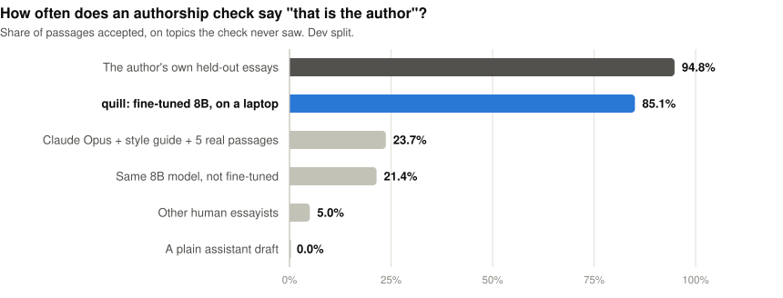
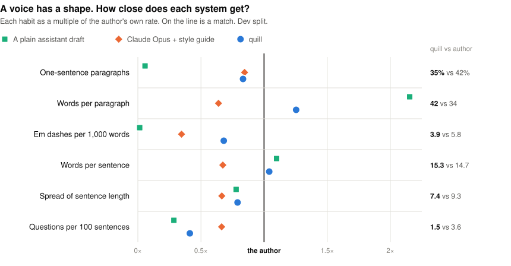
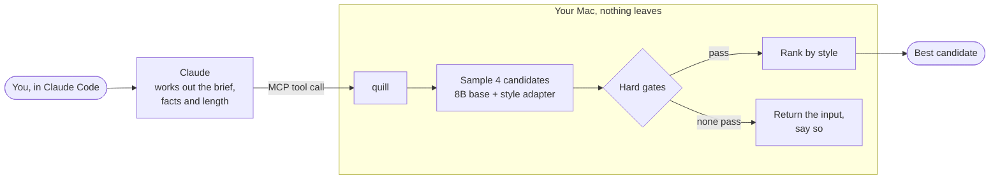
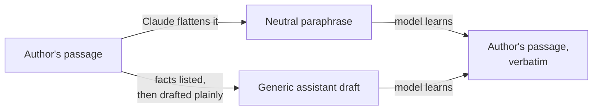

<h1 align="center">quill</h1>

<p align="center">
  A small model that runs on a Mac and rewrites your draft in one writer's voice.<br>
  Claude works out what to say. Quill handles how it reads.
</p>

<p align="center">
  
  
  
  
  
</p>

---

## You can hear it

Here are the same facts written twice.

<table>
<tr>
<th width="50%">A</th>
<th width="50%">B</th>
</tr>
<tr>
<td valign="top">

In today's fast-paced world, it's easy to overlook the quiet power of patience. Ed Marsh's story serves as a powerful testament to this timeless truth. In 1961, he planted 40 oak seedlings — a small act that would ultimately transform the landscape. It wasn't just about trees; it was about vision, commitment, and legacy. For two decades, progress was barely visible, and neighbors questioned his efforts. Although he passed away in 1999, the grove shaded two full acres by 2001. Ultimately, his journey reminds us that the most meaningful growth often happens beneath the surface.

</td>
<td valign="top">

Ed Marsh planted 40 oak seedlings in 1961.

For twenty years they looked like sticks. Neighbors asked when he planned to pull them out.

By 2001 the grove shaded two acres. Ed never saw it. He died in 1999.

Most slow things work this way. Nothing seems to happen for a very long time, and then one day it has already happened.

</td>
</tr>
</table>

You knew which one a chatbot wrote before you finished its first sentence. The tells in A are easy to list:

| Tell in A | Where |
|---|---|
| A stock opener that could start any essay | "In today's fast-paced world" |
| Praise standing in for a point | "a powerful testament to this timeless truth" |
| The "not just X, it was Y" frame | "It wasn't just about trees; it was about..." |
| A list of three abstractions | "vision, commitment, and legacy" |
| A moral tied on at the end | "his journey reminds us that..." |
| Softened facts | "passed away", "questioned his efforts" |

The tells you cannot list matter more. They show up when you count:

| | A | B |
|---|---|---|
| Words | 95 | 62 |
| Paragraphs | 1 | 4 |
| Average sentence | 13.6 words | 7.8 words |
| Shortest and longest sentence | 12 and 17 | 4 and 17 |
| Spread of sentence length (SD) | 1.8 | 3.9 |

Every sentence in A is about the same length. B has a four-word sentence next to a seventeen-word one. A person's rhythm is uneven in a way that is specific to them, and a language model's default rhythm is smooth.

<sub>Both passages were written for this README about an invented man. Neither is the author's text and neither is model output. Real samples are not shown here: the corpus stays off GitHub, and publishing the model's outputs is a consent question that is still open.</sub>

## Prompting does not fix it

The obvious move is to ask a frontier model to write like a named author, and to hand it a style guide and real examples. We did that with Claude Opus and scored the result with an authorship check trained to tell this author from other essayists and from AI drafts of his own material.

<picture>
  <source media="(prefers-color-scheme: dark)" srcset="assets/ladder-dark.svg">
  
</picture>

Prompted Opus gets the topics and the vocabulary and misses the sentences. A second Claude, shown a real passage beside Opus's best imitation of the same content, picked the real one 32 times out of 40 and the imitation once.

Quill takes the other route. It fine-tunes a small open model (Qwen3-8B, 4-bit, QLoRA) on one writer's essays, on a laptop. The first voice is Morgan Housel's writing for the Collaborative Fund blog, used with Collaborative Fund's consent.

> **Where it stands.** An adapter is trained and scored on the dev split. It has not been read blind by a person, has not touched the test split, and is not yet served as a tool. Every number here comes from [eval_reports/](eval_reports/) and the day-by-day record is in the [logbook](knowledge_base/logbook.md).

## The shape of a voice

Style is partly countable. The chart puts six habits on one scale: each system's rate as a multiple of the author's own.

<picture>
  <source media="(prefers-color-scheme: dark)" srcset="assets/fingerprint-dark.svg">
  
</picture>

A plain assistant draft writes paragraphs twice as long as his and almost never lets a sentence stand alone. Opus with a style guide overcorrects into short, clipped sentences. Quill lands nearest on four of the six. It still asks too few questions and its sentences are still too even, and both are on the list to fix.

## How it works



Four candidates are sampled. A candidate is dropped if it:

- loses or adds a name, number, date or link
- runs 30% over or under the requested length
- copies eight or more words in a row from the corpus
- contains chatbot residue ("Certainly! Here's...")

The survivors are ranked on style. If none survive, Quill returns your input unchanged and reports which check failed.

### The tool, as Claude will call it

```jsonc
// restyle: you have a draft
{ "tool": "restyle",
  "draft": "Compounding works slowly at first and then quickly. Most of the gains arrive late.",
  "length_words": 300 }

// write: you have a brief and facts
{ "tool": "write",
  "brief": "A short essay on why slow projects look like failures for most of their life.",
  "facts": ["Ed Marsh planted 40 oak seedlings in 1961", "the grove shaded two acres by 2001"] }
```

```jsonc
// both return
{ "text": "...",
  "status": "ok",              // or "fallback", with reasons
  "checks": { "entities": "kept", "meaning": 0.91, "longest_copied_span": 3 },
  "output_id": "..." }
```

This is the planned contract. The serving layer is Phase 9 and nothing above is captured output.

## Training runs backwards

Teaching a model to "write like this author" from a topic alone also teaches it to make things up. So each training example starts from the author's passage and works backwards to a plain input.



The model learns the trip from plain to voiced. Every fact in a target is already in its input, so there is nothing to invent.

One training example (synthetic text; the corpus is not in this repo):

```json
{"messages": [
  {"role": "system",    "content": "quill v2\nop: restyle\ninput: draft\nlength: 150-300\nvoice: v0"},
  {"role": "user",      "content": "Ed Marsh planted 40 oak seedlings in 1961. For two decades, progress was barely visible."},
  {"role": "assistant", "content": "Ed Marsh planted 40 oak seedlings in 1961. For twenty years they looked like sticks."}
]}
```

About half of the drafts come from Claude and half from the untuned local model, since that model writes the drafts at run time.

## What the experiments showed

The scoring harness was built before any model was trained, and each metric had to pass a sanity check on held-out text first. Splits are by topic, so the model is tested on subjects it never trained on.

| System, dev split, 4 candidates | Accepted as the author | Read as an LLM | Meaning kept | Falls back to the input |
|---|---|---|---|---|
| The author's own held-out essays | 94.8% | | | |
| Claude Opus + style guide + 5 passages | 23.7% | 72.4% | | 16.1% |
| Qwen3-8B, not fine-tuned | 21.4% | 77.3% | 0.87 | 14.5% |
| Quill, trained on paraphrases | 72.4% | 23.7% | 0.89 | 10.5% |
| **Quill, trained on paraphrases and drafts** | **85.1%** | **9.1%** | **0.90** | **12.9%** |

Things that turned out to be true:

- **Training on drafts alone reaches the author's ceiling and breaks the facts.** That adapter was accepted 98% of the time, and four in ten of its candidates lost or added a name or number. Training on paraphrases and drafts together kept most of the style and held the facts. Ten optimizer steps were enough to see the trade.
- **Most dropped facts came from the drafter.** When the untuned model wrote a draft from notes, two thirds of its drafts already lost or added an item. Having it redraft with the missing items named cut the fallback rate from 30% to 10%.
- **Merging the adapter into 4-bit weights erases it.** The merged model scored like the untuned one. Merging at full precision and re-quantizing to 6 bits keeps the voice and runs at about 30 tokens a second.
- **A zero-shot AI detector could not tell Opus's imitation from the author** (AUC 0.50). It was dropped from the harness.
- **The first authorship check was fooled by fluency.** It accepted half of plain Claude drafts of the author's content until such drafts were added to its negatives.

What is not established yet:

- **No person has judged an output.** The checks above were built in this project, and a model can satisfy them without convincing a reader. A blind reading kit exists (40 pairs, pick the real one) and has not been run.
- **Dev has been reused.** About eight adapter variants were compared on the same 62 passages. The test split is untouched and gets one run, with the final system.
- **The baselines are slightly handicapped.** They ran without the redraft step. Like for like, the first adapter's lead over the untuned model on the combined score is 0.25, with a 95% interval of 0.16 to 0.35.
- **The inputs so far are the author's own material.** How it does on a stranger's draft about something else is not measured.

## Roadmap

| | Phase | State |
|---|---|---|
| ✓ | 0 Source and consent audit | Done, except the stored consent copy |
| ✓ | 1 Extraction and cleaning | Done. 330 posts, 318,971 words, 835 chunks |
| ✓ | 2 Splits, eval harness, baselines | Done on dev |
| ✓ | 3 Training pairs | Done. 675 paraphrase pairs and 641 draft pairs ([report](eval_reports/pairs-v1.md)). A human read of 50 pairs is still open |
| ✓ | 4 Model bake-off | Done. Qwen3.5-9B could not be trained on this Mac with mlx-lm; Qwen3-8B can ([logbook](knowledge_base/logbook.md)) |
| ● | 5 Style fine-tune and ablations | In progress. Best adapter: dev composite 0.76 against 0.26 untuned and 0.25 for prompted Opus ([open questions](knowledge_base/followup.md)) |
| | 6 Inference pipeline | |
| | 8 Ship gate | Blind reads on the untouched test split |
| | 9 MCP serving in Claude Code | |

The ship gate: a reader who knows the author must be unable to reliably pick the real passage (at most 25 of 40 correct), and the adapter must beat Opus's imitation head to head (at least 26 of 40). The full plan, with every threshold and its source, is in [knowledge_base/plan.md](knowledge_base/plan.md).

## Run it

Needs [uv](https://docs.astral.sh/uv/), Python 3.12 and an Apple Silicon Mac.

```
uv sync
uv run pytest
```

The repo holds code and aggregate numbers only. Bring your own corpus, one you have the right to use. Data lives in `~/.quill/`, outside the repo; raw pages go in `~/.quill/raw/collabfund/pages/`. Paths and thresholds are in [configs/quill.yaml](configs/quill.yaml).

```
uv run quill ingest                  # pages -> clean, deduped chunks
uv run quill split                   # freeze topic-disjoint train/dev/test
uv run quill eval --sanity           # prove each metric works before trusting it
uv run quill baseline b0             # the bar: Claude + style guide + exemplars
uv run quill pairs                   # build and curate the training pairs
uv run quill train NAME --stage s1p  # fine-tune an adapter with mlx-lm
uv run quill run NAME --adapter NAME --tag paraphrase --n 4   # generate on dev and score
```

<details>
<summary><b>Every command</b></summary>

| Command | What it does |
|---|---|
| `uv run quill audit` | Inventories the raw pages and checks them against the Phase 0 figures |
| `uv run quill ingest` | Extracts, cleans, dedupes and chunks the pages into `~/.quill/corpus/corpus.sqlite`; writes `cleaning_report.md` |
| `uv run quill aicheck` | Builds lexicon v0 and flags posts dated after 2022-12-01 for review; writes `ai_flags.md` |
| `uv run quill flags [slug keep\|drop]` | Lists the flags, or records a decision on one |
| `uv run quill spotcheck [--seed S] [--record N --note TEXT]` | Writes 100 random chunks for a read; records the count of bad ones |
| `uv run quill gate` | Shows the Phase 1 exit gate |
| `uv run quill split` | Freezes topic-disjoint train/dev/test splits, or shows the frozen ones |
| `uv run quill eval --sanity` | Checks each style metric on dev and recomputes the within-author ceiling |
| `uv run quill eval --system NAME --split dev` | Scores a system; reports go to `eval_reports/` |
| `uv run quill eval --verifiers` | Compares the style scorers on author text against plain drafts of the same content |
| `uv run quill inputs` | Makes and freezes the eval inputs for dev and test: facts, a brief and a generic draft per chunk (Claude, through `claude -p`) |
| `uv run quill baseline b0\|b1\|b2 [--split dev] [--n 4]` | Runs and scores a baseline: Claude with a style guide and exemplars, the untuned local base, or the draft itself |
| `uv run quill recall [--split dev] [--adapter NAME]` | Probes the base, untuned or with an adapter loaded, for verbatim recall of the corpus |
| `uv run quill eval --compare A B` | Paired bootstrap of the decision composite, A minus B |
| `uv run quill eval --detector` | Sanity check of the machine-text detector (M10) |
| `uv run quill judge` | Validates the Claude pairwise judge (M11) and compares the scored systems |
| `uv run quill blind --test A\|R --system NAME` | Builds a blind reading kit, runs the read in the terminal, reports the binomial p |
| `uv run quill baseline b1 --split coverage` | Coverage probe on your own briefs in `~/.quill/eval/coverage/briefs.jsonl` |
| `uv run quill eval --report` | Writes the Phase 2 exit report |
| `uv run quill pairs` | Paraphrases each train and dev chunk, curates both pair forms, writes the MLX chat data and `eval_reports/pairs-v1.md` |
| `uv run quill pairs --local` | Adds the local half of the draft pairs: the untuned base drafts from each fact list. No Claude calls |
| `uv run quill train NAME [--stage s1\|s1p\|s2\|s2m] [--resume ADAPTER] [--lr LR] [--passes N]` | Trains an adapter with mlx-lm on one pair set; logs loss, speed and peak memory |
| `uv run quill run NAME --adapter ADAPTER [--tag paraphrase\|draft] [--n 4] [--fused PATH]` | Generates with an adapter (or a merged copy) on the eval inputs and scores it |
| `uv run python scripts/readme_charts.py` | Redraws the README charts from the reports in `eval_reports/` |

Run them in that order. `inputs`, `baseline b0`, `judge` and `pairs` send corpus text to Claude; they stop unless `scope.yaml` says `claude_api: yes`. `baseline b1` and `recall` need the base model at the `gen.base_model` path. The meaning, LUAR and detector scorers need local model copies under `~/.quill/models/` (`mis`, `luar-mud`, `gpt-neo-2.7b`). A rebuild with `ingest` keeps flag decisions and clears the spot-check result.

</details>

<details>
<summary><b>What the cleaning pipeline does</b></summary>

1. **Extract.** A parser for the Collab Fund page layout keeps body paragraphs, list items and headings. It drops navigation, share bars, newsletter boxes and captions.
2. **Clean.** Block quotes, embedded tweets, epigraphs, whole-paragraph quotations, related-post lists, promo lines and separators go. Every dropped block is stored with a reason.
3. **Drop posts.** Posts by other authors, posts under 120 words, and posts named in `corpus.drop_posts` (book announcements, interviews, a transcript).
4. **Twins.** Posts that share more than 30% of their 10-grams get a `twin_group`, so they stay on one side of every split.
5. **Dedupe.** MinHash over paragraphs keeps the earliest copy of each repeated paragraph.
6. **Chunk.** 150-800 words on paragraph boundaries, in three length buckets. Chunks carry flags such as `list`, `quote_gap` and `dangling_leadin`. `text` holds the author's words only; `text_marked` adds a `<QUOTE>` or `<IMAGE>` line where one was removed.
7. **AI-text check.** Three review signals on later posts: lexicon rates above the author's own pre-cutoff 95th percentile, a sustained style shift (PELT), and LLM mentions or chatbot referrer links. Nothing is dropped without a decision.
8. **PII.** A regex pass for email addresses and phone numbers.

</details>

<details>
<summary><b>Repo layout</b></summary>

```
configs/
  quill.yaml            paths, thresholds, dropped posts, decisions
  lexicon/              seed lexicon v0 and the Kobak excess-word list
  prompts/              prompts for eval inputs, pairs, B0/B1, the judge and the recall probe
  train/                mlx-lm training configs
src/quill/
  cli.py                the commands above
  template.py           the one prompt template, shared by training and serving
  audit.py              Phase 0 inventory
  ingest/               page parser; textlib (the Phase 0 reader and stylometrics)
  clean/                boilerplate, twins, dedupe, chunk, pii_regex, ai_check
  corpus/               build (the pipeline), store (SQLite), gate, split
  scorers/              lexicon, contrast, av (verifier, attribution), stylometry, memo, entities, embed, meaning (MIS, fact entailment), detect
  gen/                  claude_cli (`claude -p` with a cache), local (mlx-lm with a cache)
  eval/                 pool, harness (metrics, composite), inputs, baselines (B0-B2, recall probe), vcheck, judge, blind, coverage
  train.py              one mlx-lm training stage: config, schedule, log parsing
  pairs/                generate (paraphrases, marker placement), curate, local (base-model drafts), to_mlx, build
eval_reports/           aggregate metrics only
assets/                 README charts (SVG), drawn by scripts/readme_charts.py
scripts/                readme_charts.py
tests/                  synthetic text only; no corpus text
knowledge_base/         plan, experiment logbook, literature review, research notes, decision docs
```

</details>

## Ground rules

The model imitates a living writer. These rules apply, and the ones that can be enforced in code are.

- **Consent first.** The corpus is used under the rights holder's consent, recorded in `~/.quill/legal/scope.yaml`. Any use marked unknown there is blocked in code.
- **Local only.** The corpus, adapters and weights never leave the machine and are not in this repo. `.gitignore` blocks weights, databases, JSONL and HTML.
- **No passing off.** Outputs are never presented as the author's own writing. Tool, file and adapter names never carry the author's name.
- **No copying.** A hard gate rejects any output that shares a long verbatim span with the corpus. One known limit: given a close paraphrase of one of the author's own passages, the adapter rebuilds some of the original wording. That is measured and reported, not gated; the tool is for restyling your own drafts.
- **Polite crawling.** Raw pages are cached once and never re-fetched. Crawls honour robots.txt, AI opt-outs and crawl delays.

Details are in [knowledge_base/plan.md](knowledge_base/plan.md), section 2.4. Nothing here is legal advice.

## Credits

- `configs/lexicon/kobak_excess_words.csv`: Kobak et al., [llm-excess-vocab](https://github.com/berenslab/llm-excess-vocab), MIT. Licence in `configs/lexicon/kobak_LICENSE`.
- `src/quill/scorers/contrast.py`: a port of the stage-1 regexes from [slop-score](https://github.com/sam-paech/slop-score), Copyright (c) 2025 Sam Paech, MIT.
- Models used locally, not redistributed: [Mutual Implication Score](https://huggingface.co/s-nlp/Mutual_Implication_Score) (CC BY-NC-SA 4.0), [LUAR-MUD](https://huggingface.co/rrivera1849/LUAR-MUD), [StyleDistance](https://huggingface.co/StyleDistance/styledistance), [gpt-neo-2.7B](https://huggingface.co/EleutherAI/gpt-neo-2.7B), [DeBERTa-v3 MNLI](https://huggingface.co/MoritzLaurer/DeBERTa-v3-base-mnli-fever-anli), spaCy `en_core_web_sm`.
- `configs/lexicon/seed_v0.yaml`: vocabulary and patterns drawn from Wikipedia's [Signs of AI writing](https://en.wikipedia.org/wiki/Wikipedia:Signs_of_AI_writing), CC BY-SA 4.0.
